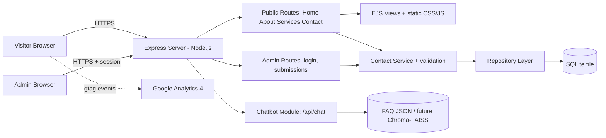
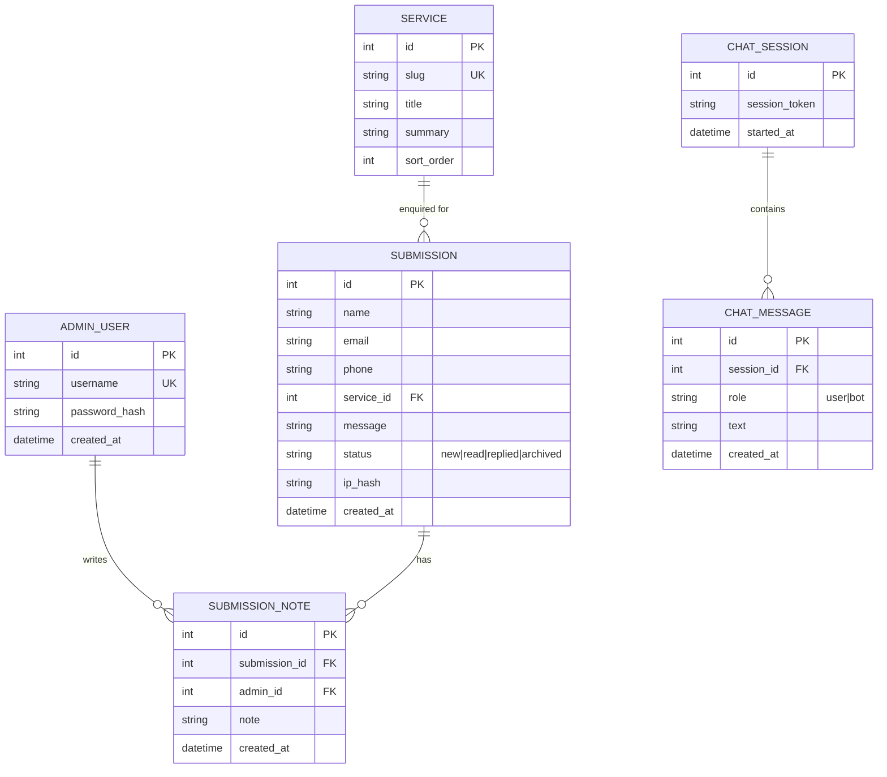
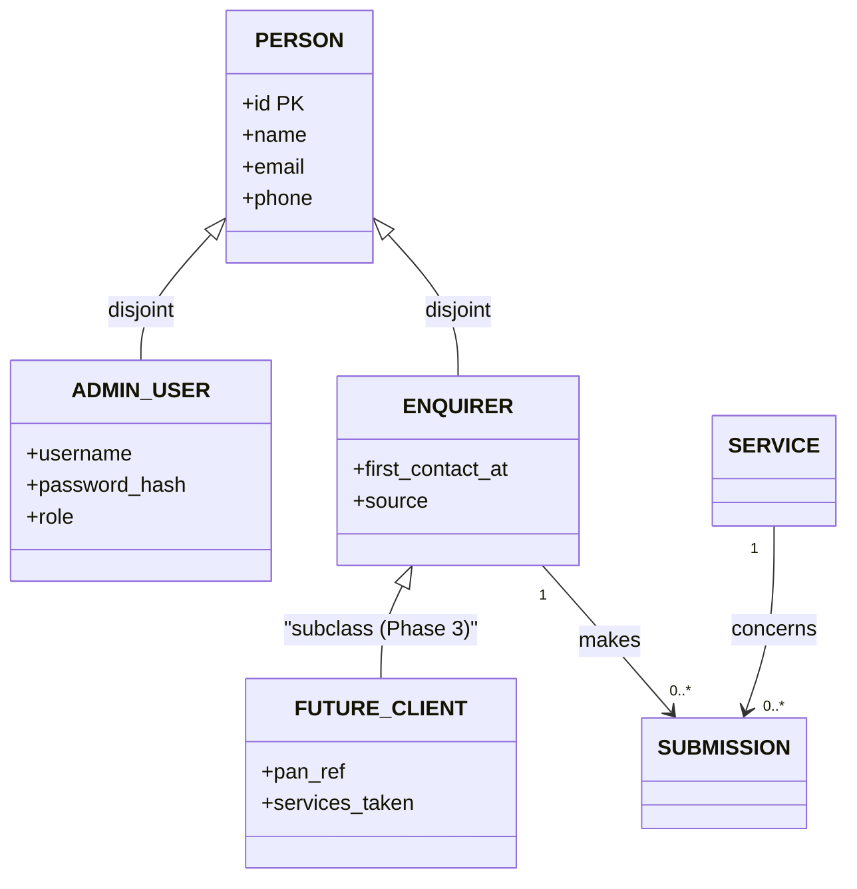
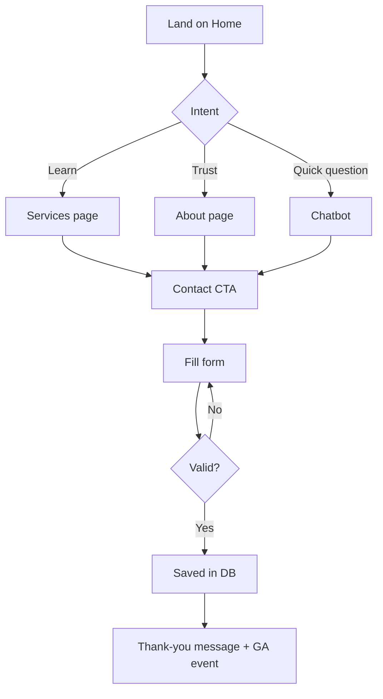

# Architecture

## 1. 1D View — Layer Stack (one-dimensional)
```
Browser → Express routes → Controllers → Services → Repositories → SQLite
                                   ↘ Feature modules (chatbot, analytics)
```

## 2. 2D View — System Diagram


## 3. Folder Structure (modular & extendable)
```
portfolio/
├─ server.js
├─ .env
├─ config/        (index.js, features.js)
├─ db/            (schema.sql, connection.js, repositories/)
├─ modules/       (contact/, admin/, chatbot/, analytics/)   ← each feature = routes+controller+service
├─ views/         (layouts/, partials/, pages/, admin/)
├─ public/        (css/, js/, img/)
├─ middleware/    (auth.js, rateLimit.js, validate.js)
└─ docs/          (prd.md, architecture.md, design.md, phase.md, memory.md)
```
**Extension rule:** a new feature = a new folder in `modules/` + one line in `config/features.js` (`blog: true`).

## 4. ER Diagram


## 5. EER Diagram (with specialisation)
`PERSON` is generalised into admin and enquirer to allow future roles (staff, clients).

MVP physically implements `SUBMISSION` and `ADMIN_USER` only; the EER is the extension plan. Disjoint, partial specialisation.

## 6. User Flows
### Visitor / customer

### Admin
```mermaid
flowchart TD
  L[/admin/login] --> M{Credentials ok?}
  M -->|No| L
  M -->|Yes| N[Dashboard: counts]
  N --> O[Submissions list: search, filter]
  O --> P[View detail] --> Q[Mark read/replied, add note, export CSV]
  N --> R[Logout]
```

## 7. Key API Endpoints
| Method | Path | Purpose |
|---|---|---|
| GET | `/`, `/about`, `/services`, `/contact` | Pages |
| POST | `/contact` | Submit enquiry |
| POST | `/api/chat` | Chatbot reply |
| GET/POST | `/admin/login`, `/admin/logout` | Auth |
| GET | `/admin/submissions` | List |
| GET/POST | `/admin/submissions/:id` | View / update status |
| GET | `/admin/submissions/export.csv` | Export |

## 8. Chatbot Design
- **MVP:** `faq.json` with intents/keywords → best match → answer, else fallback "Please leave your details" + link to form (vectorless).
- **Phase 2:** knowledge base chunks → embeddings → Chroma or FAISS → retrieve → LLM answer. Swappable behind `chatbot/engine.js`.

## 9. Security
helmet headers, rate limit on `/contact` and `/admin/login`, parameterised SQL, server-side validation, honeypot field, bcrypt, session cookie `httpOnly; secure; sameSite`, escape output.

## 10. Analytics Events (GA4)
`page_view`, `generate_lead` (form success), `chat_open`, `chat_message`, `click_call`, `click_email`, `scroll_depth`.
